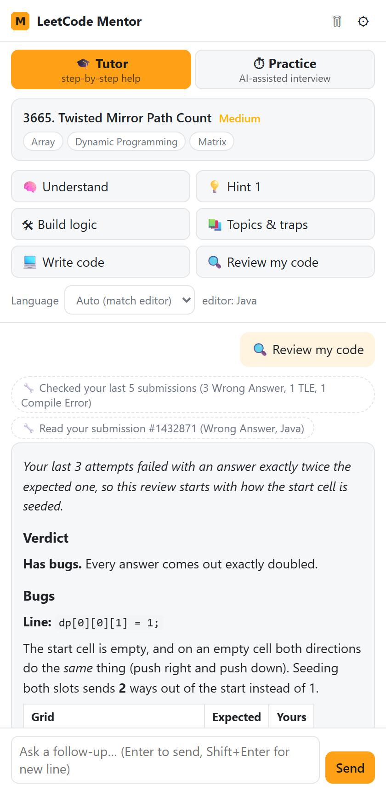
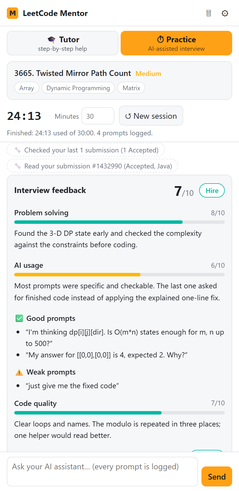
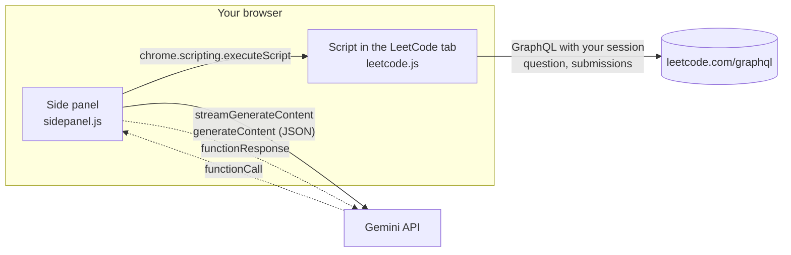
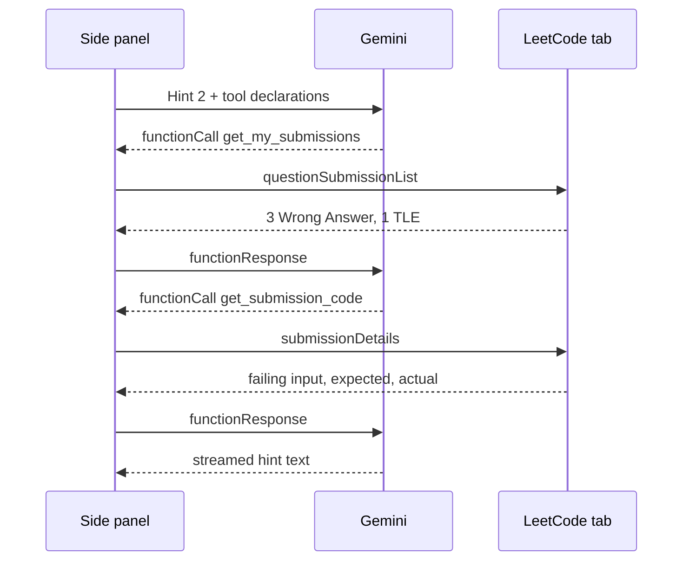

# LeetCode Mentor

A Chrome side panel that explains any LeetCode problem step by step in plain language, using the Gemini API, and runs timed AI-assisted mock interviews.


<!-- TODO: record a 20-30 second demo (Hint with tool chips, then a Practice round and its scorecard),
     save it as assets/demo.gif, and uncomment the next line.

-->

| Tutor: a code review that checked past submissions first | Practice: scorecard after an AI-assisted round |
|---|---|
|  |  |

## Features

| Area | Feature | What it does |
|---|---|---|
| **Tutor mode** | 🧠 Understand | The problem in plain words, a walkthrough of Example 1, easy-to-miss rules, edge cases, and what the constraints say about the complexity you can afford. No spoilers. |
| | 💡 Hint 1 → 4 | One hint at a time: observation → key insight → state / data structure → algorithm outline. |
| | 🛠 Build logic | Brute force → why it is too slow → key observation → optimized approach, with a dry-run table and complexity. |
| | 📚 Topics & traps | Each concept from scratch, with a code template, how to recognize it, common interview traps and related problems. |
| | 💻 Write code | A solution in your language with LeetCode's exact signature and a line-by-line explanation of why. |
| | 🔍 Review my code | Reads your editor, gives a verdict, shows a failing input (expected vs actual) and the minimal fix. |
| | 💬 Follow-up chat | Ask anything. The chat and hint progress are saved per problem. |
| | Explanation level | Beginner, Intermediate or Interview prep. Each level has its own system prompt. |
| **Agentic step** | 🔧 Past submissions | For hints, reviews and follow-ups, Gemini can call tools that read your own LeetCode submissions (status, failing test, code) and adapts its answer, e.g. *"Your last 2 attempts failed on an empty array, so this hint focuses on edge cases."* Each tool call is shown as a chip above the answer. |
| **Practice mode** | ⏱ Timed round | Simulates an AI-allowed coding interview. Start a timer (30 min by default) and use the chat as your AI assistant. Every prompt is logged with its time. |
| | 🏁 Scorecard | On finish, the final code, your latest submission and the prompt log are graded into a JSON scorecard: problem solving, **AI usage** (specific questions vs. "give me the answer"), code quality, correctness, 3 tips and a hire verdict. |

## How it works



There is no backend. The side panel talks to two places: the LeetCode tab (through `chrome.scripting`, so requests are same-origin and use your logged-in session) and the Gemini API (with your own key).

### The agent loop



1. The request goes to Gemini with three function declarations: `get_my_submissions`, `get_submission_code` and `get_recent_accepted`.
2. If the reply contains `functionCall` parts, the side panel runs each one in the LeetCode tab and sends the results back as `functionResponse` parts.
3. This repeats at most 3 times. After that, tools are switched off (`functionCallingConfig.mode = "NONE"`) so the model must answer.
4. The final answer streams into the panel. If the model calls no tool, it is a single streamed request, the same as before tools existed.

The code is in `streamChat` in [gemini.js](gemini.js) and `runTool` in [leetcode.js](leetcode.js).

### The structured-output scorecard

"Finish & get feedback" reads the editor and the latest submission, then makes one `generateContent` call with `responseMimeType: "application/json"` and a `responseSchema` ([prompts.js](prompts.js)). The schema fixes the shape: integer scores from 0 to 10, an enum for the correctness verdict and the hire verdict, and exactly 3 improvement tips. `propertyOrdering` puts the overall score after the parts, so the model grades the parts first.

The reply is still validated in [practice.js](practice.js): scores are clamped, unknown enum values are replaced, and lists are trimmed. If the JSON can't be parsed, the panel shows the raw reply instead of failing. The scorecard is built with DOM `textContent`, so no model output is injected as HTML.

## Tech stack and design decisions

- **Plain JavaScript (ES modules), Manifest V3, no build step.** The folder loads as-is with "Load unpacked". Markdown rendering uses `marked` and `DOMPurify`, bundled in `lib/`.
- **No backend, zero cost.** All calls go from the browser to Gemini's free tier. Nothing to host or pay for.
- **User-owned API key.** Each user pastes their own free key. It is stored in `chrome.storage.local` and never in the code.
- **Function calling instead of always sending submissions.** The model decides when past attempts matter. A concept question costs one request, and a hint about a failing attempt fetches exactly the data it needs.
- **Every agent round streams.** Tool rounds use the same streaming endpoint as normal answers, so a reply without tool calls needs no extra request. This matters on free-tier rate limits.
- **JSON schema for feedback.** A schema turns grading into data that the UI can draw as score bars, and avoids fragile parsing of Markdown.
- **Token-saving limits.** Only the last 24 chat messages are sent, submission code is capped at 4,000 characters, and tool results only include the fields the prompt needs.
- **Prompts are data.** Each mode and level is a template in [prompts.js](prompts.js), with Tutor and Practice prompts in separate sections.

## Install

1. Get the code: click **Code → Download ZIP** on this page and unzip it, or run
   ```bash
   git clone https://github.com/AnnieMahajan454/leetcode-mentor.git
   ```
2. Open `chrome://extensions` in Chrome (Edge and Brave work too).
3. Turn on **Developer mode** (top right).
4. Click **Load unpacked** and select the `leetcode-mentor` folder.
5. Pin the **M** icon from the puzzle-piece menu.

Then:

1. Get a free Gemini API key at [aistudio.google.com/apikey](https://aistudio.google.com/apikey) (no credit card).
2. Open any problem, e.g. `https://leetcode.com/problems/two-sum/`.
3. Click the **M** icon or press **Alt+M**. Paste the key in Settings, click **Load models**, then **Save**.
4. Stay signed in to LeetCode if you want answers based on your past submissions.

To preview the UI without the extension, serve the folder (`python -m http.server`) and open `http://localhost:8000/sidepanel.html`. It runs with demo data from [demo.js](demo.js).

## Privacy

- **Sent to Gemini:** the problem text, your questions, your editor code when you click Review or finish a Practice round, and (if the setting is on) the submission data the model asks for: status, runtime, failing test and code.
- **"Use my past submissions"** in Settings is on by default. Turn it off and no submission data is read or sent.
- **Stays in your browser:** your API key, chats, hint progress and Practice logs, all in `chrome.storage.local`.
- **Free-tier note:** on Gemini's free tier, Google may use prompts to improve its models. Don't send anything confidential.

## Project structure

```
manifest.json     extension config (Manifest V3)
background.js     opens the side panel on icon click
sidepanel.*       the UI: Tutor and Practice views, settings
prompts.js        system prompts, mode templates, Practice prompts and the scorecard schema
gemini.js         Gemini client: streaming, agent loop, tool declarations, JSON output
leetcode.js       runs in the LeetCode tab: problem, editor, submission tools
practice.js       Practice timer helpers, scorecard validation and rendering
demo.js           sample data for the UI preview
lib/              marked (MIT) and DOMPurify (Apache-2.0 / MPL-2.0), unmodified
assets/           screenshots for this README
```

## Limitations

- LeetCode has no official API. The GraphQL queries match leetcode.com today and may need updates if LeetCode changes its schema. On leetcode.cn, the submission tools report an error and answers continue without them.
- With tools on, one answer can use up to 4 Gemini requests. On free-tier per-minute limits, switch to a Flash-Lite model if you hit them.

## Roadmap

- Publish on the Microsoft Edge Add-ons store (free to list).
- Optional background music in Practice mode that matches the problem's difficulty.

## Author

**Annie Mahajan**: [GitHub](https://github.com/AnnieMahajan454) · [LinkedIn](https://www.linkedin.com/in/YOUR-LINKEDIN-HANDLE) <!-- TODO: replace with your LinkedIn URL -->

Released under the [MIT License](LICENSE).
